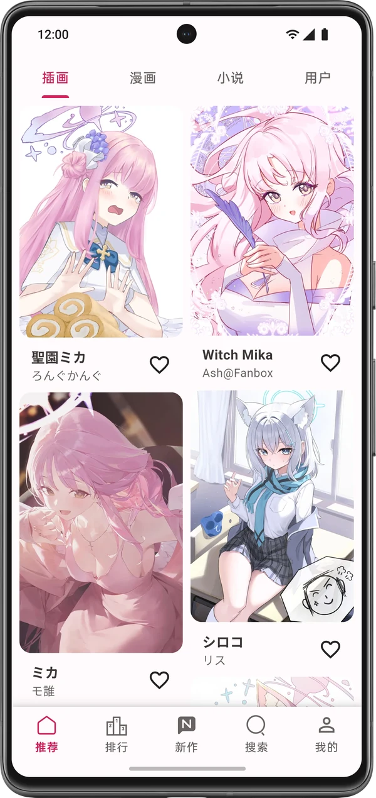
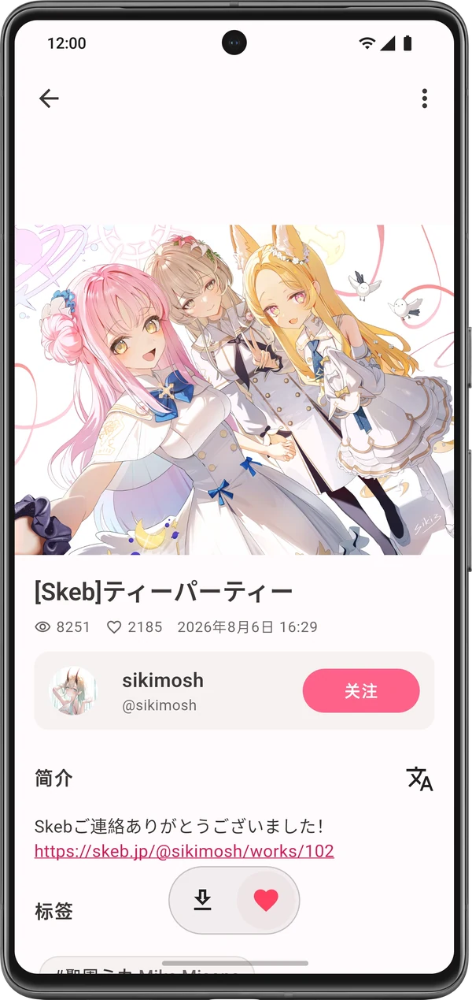
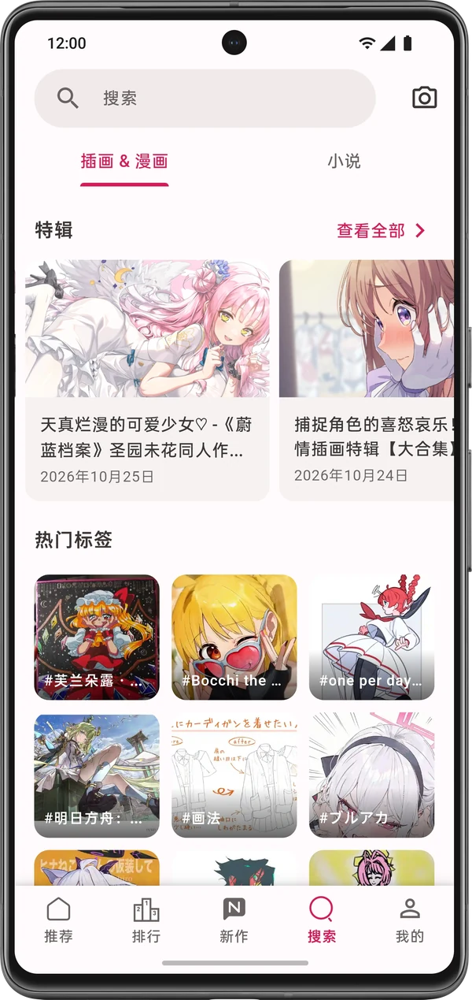
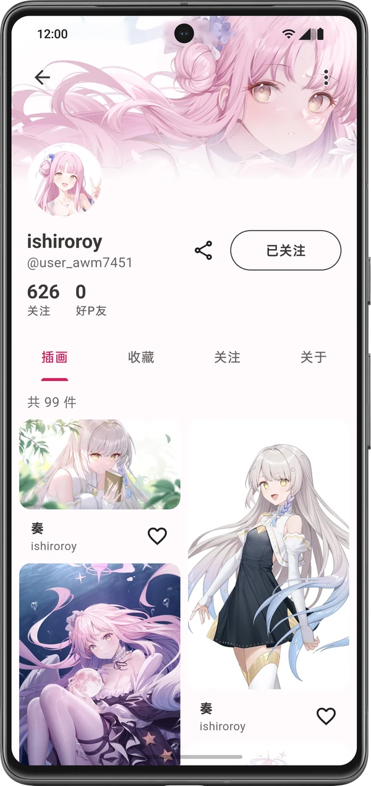
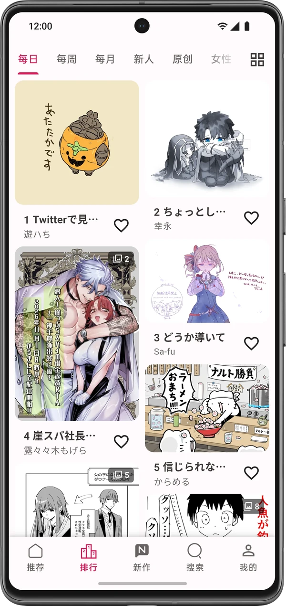
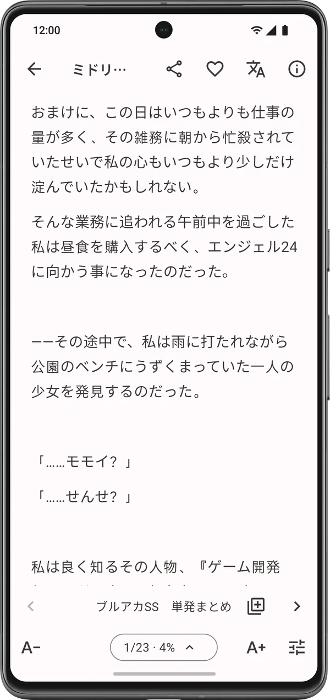
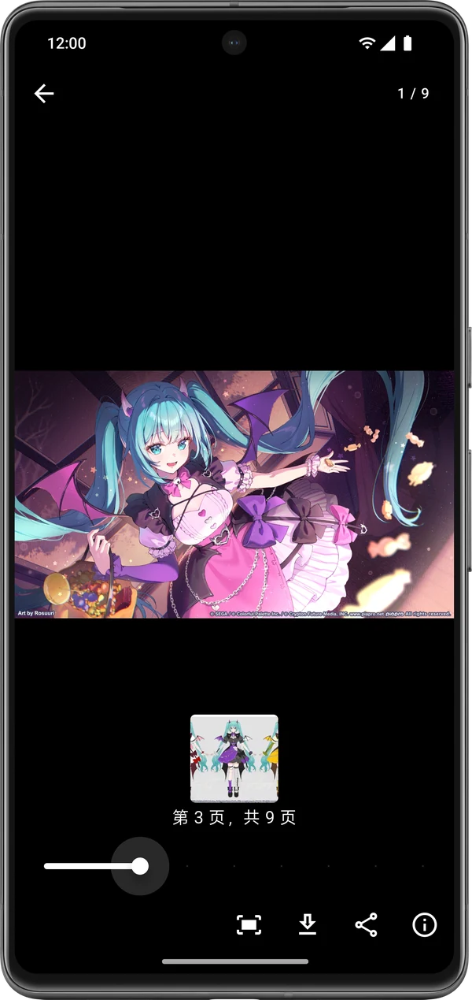
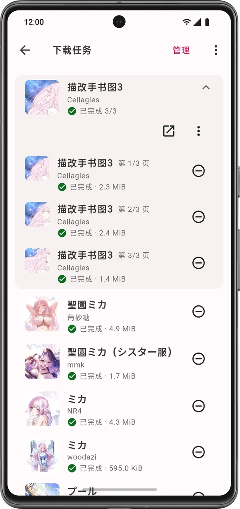

<div align="center">


[](https://github.com/Lopution/Parfait/releases/latest)
[](#download)
[](LICENSE)
[](https://github.com/Lopution/Parfait/actions/workflows/ci.yml)

**[⬇️ Download the latest release](https://github.com/Lopution/Parfait/releases/latest)** · **[FAQ](#faq)** · **[Contact](#contact)**

[简体中文](README.md) | English

</div>

> [!NOTE]
> Parfait is an unofficial client and is not affiliated with pixiv Inc. All works belong to their creators; downloads are for your personal collection, so please do not re-upload them or use them commercially.

Parfait is an unofficial pixiv client for Android. It started from the open-source Pixiv Func.

The original project is no longer maintained, and direct access to pixiv from mainland China keeps changing, so Parfait rewrites the client in Flutter and Rust: a Material Design 3 interface on a network stack rebuilt in Rust, aimed at the everyday problems of connecting, loading images and downloading in bulk:

- **Direct access out of the box**: no proxy needed for browsing and downloads (except the first sign-in, see [Signing in](#signing-in)). When something does not connect, the built-in layered connectivity probe tells DNS poisoning from SNI blocking. Direct access applies to pixiv's domains only and never touches other apps' traffic.
- **Viewing and reading**: illustrations, manga, ugoira (savable as GIF) and novels; follow manga and novel series, reverse image search across several engines, translate comments in one tap, and two-pane layouts on tablets, foldables and phones in landscape.
- **Bulk downloads that work**: download a selection or every work of an artist; multi-page works are grouped, downloads resume where they stopped, file names follow your template, and each work's caption can be saved to a TXT file.
- **Nothing in the way**: no ads, analytics or telemetry. Permissions are network, vibration (haptics) and installing apps (in-app updates only); from Android 17, Parfait also asks for Nearby devices, and only when an image source, DoH, translation endpoint or system proxy you set is on your local network. Login credentials stay in the system's secure storage, and logs stay on the device.

## Screenshots

<!-- The no-break spaces under the last row keep every column as wide as a screenshot: on a phone the table scrolls sideways instead of shrinking them. -->
<table align="center">
<tr>
<td align="center" valign="top"><br><b>Recommended</b><br><sub>Illustrations, manga, novels and users</sub></td>
<td align="center" valign="top"><br><b>Artwork</b><br><sub>Details, comments and related works</sub></td>
<td align="center" valign="top"><br><b>Search</b><br><sub>Features, trending tags, reverse image search</sub></td>
<td align="center" valign="top"><br><b>Artist</b><br><sub>Works, bookmarks and follows</sub></td>
</tr>
<tr>
<td align="center" valign="top"><br><b>Rankings</b><br><sub>33 categories, any past date</sub><br>&nbsp;&nbsp;&nbsp;&nbsp;&nbsp;&nbsp;&nbsp;&nbsp;&nbsp;&nbsp;&nbsp;&nbsp;&nbsp;&nbsp;&nbsp;&nbsp;&nbsp;&nbsp;&nbsp;&nbsp;&nbsp;&nbsp;&nbsp;&nbsp;&nbsp;&nbsp;&nbsp;&nbsp;&nbsp;&nbsp;&nbsp;&nbsp;&nbsp;&nbsp;&nbsp;&nbsp;&nbsp;&nbsp;&nbsp;&nbsp;</td>
<td align="center" valign="top"><br><b>Novel reader</b><br><sub>Font, colours and one-tap translation</sub><br>&nbsp;&nbsp;&nbsp;&nbsp;&nbsp;&nbsp;&nbsp;&nbsp;&nbsp;&nbsp;&nbsp;&nbsp;&nbsp;&nbsp;&nbsp;&nbsp;&nbsp;&nbsp;&nbsp;&nbsp;&nbsp;&nbsp;&nbsp;&nbsp;&nbsp;&nbsp;&nbsp;&nbsp;&nbsp;&nbsp;&nbsp;&nbsp;&nbsp;&nbsp;&nbsp;&nbsp;&nbsp;&nbsp;&nbsp;&nbsp;</td>
<td align="center" valign="top"><br><b>Viewer</b><br><sub>Scrub through pages, save and share</sub><br>&nbsp;&nbsp;&nbsp;&nbsp;&nbsp;&nbsp;&nbsp;&nbsp;&nbsp;&nbsp;&nbsp;&nbsp;&nbsp;&nbsp;&nbsp;&nbsp;&nbsp;&nbsp;&nbsp;&nbsp;&nbsp;&nbsp;&nbsp;&nbsp;&nbsp;&nbsp;&nbsp;&nbsp;&nbsp;&nbsp;&nbsp;&nbsp;&nbsp;&nbsp;&nbsp;&nbsp;&nbsp;&nbsp;&nbsp;&nbsp;</td>
<td align="center" valign="top"><br><b>Downloads</b><br><sub>Grouped by work, pause and resume</sub><br>&nbsp;&nbsp;&nbsp;&nbsp;&nbsp;&nbsp;&nbsp;&nbsp;&nbsp;&nbsp;&nbsp;&nbsp;&nbsp;&nbsp;&nbsp;&nbsp;&nbsp;&nbsp;&nbsp;&nbsp;&nbsp;&nbsp;&nbsp;&nbsp;&nbsp;&nbsp;&nbsp;&nbsp;&nbsp;&nbsp;&nbsp;&nbsp;&nbsp;&nbsp;&nbsp;&nbsp;&nbsp;&nbsp;&nbsp;&nbsp;</td>
</tr>
</table>

## Features

- **Browse and search**: recommendations and pixivision features; rankings in 21 illustration and 12 novel categories, for any past date, with categories you can reorder or hide; search completes each keyword and filters by bookmark count, date and AI-generated works; reverse image search with SauceNAO, IQDB, ascii2d and TinEye.
- **Network and image sources**: network mode Automatic, Direct only or Compatibility-first; the image source is picked by speed on your network, or set to a public mirror such as pixiv.re or your own reverse proxy.
- **Novels and series**: a reader with adjustable font size and line spacing, and paper, eye-care and night themes; follow manga and novel series; import local TXT novels with automatic encoding detection.
- **Collections and muting**: bookmarks with tags, follows, watch later and history; mute tags, users or single works, or hide R-18 and AI-generated works locally.
- **Comments and translation**: comment right on the artwork page, with emoji and stickers; translate comments and novels with Google Translate, Baidu Translate, Doubao (signed in with your own account) or any OpenAI-compatible endpoint. Text or images go to the service you chose only when you translate or search.
- **Your setup, on any device**: multiple accounts, and move your login to another device; back up and import settings, mute lists and history; choose the bottom bar pages, the start page and the grid density; English, 日本語, Русский and 中文, with colours from your wallpaper.

## Download

Download an APK from [Releases](https://github.com/Lopution/Parfait/releases/latest) (**Android 10** or later):

| File | For |
|---|---|
| `parfait-v<version>-github-arm64-v8a.apk` | Almost every phone; pick this if unsure |
| `parfait-v<version>-github-armeabi-v7a.apk` | Older 32-bit devices |

> A Windows build is in preparation and will ship as a preview.

Parfait is **released on GitHub Releases only**. Copies on cloud drives, in group chats or elsewhere are third-party reposts; get it from Releases or check the signing fingerprint below. Later updates are under **Me → About → Check for updates** in the app, or track this repository with [Obtainium](https://github.com/ImranR98/Obtainium).

<details>
<summary>Check the APK signing certificate</summary>

Every APK on Releases is signed with the same certificate. On the phone you can check it with [AppVerifier](https://github.com/soupslurpr/AppVerifier); package name and SHA-256 fingerprint should be:

```text
io.github.lopution.parfait
D0:B4:1A:FC:87:B7:D2:07:51:1A:52:BD:8C:CC:A6:56:3C:67:3C:2D:F1:0A:67:71:D1:C3:38:4A:B6:5C:B1:12
```

On a computer, use `apksigner` from the Android SDK:

```bash
apksigner verify --print-certs parfait-v<version>-github-arm64-v8a.apk
# The output should contain:
# Signer #1 certificate SHA-256 digest: d0b41afc87b7d207511a52bd8ccca6563c673c2df10a6771d1c3384ab65cb112
```

</details>

## Signing in

Parfait signs in through pixiv's official web page (OAuth). The page, including its human verification, opens in a WebView that uses the system network rather than Parfait's direct-access stack, so **the first sign-in or registration needs a proxy set up in the system or another app**. After that, browsing and downloads connect directly.

Already signed in on another device? There, open **Me → Accounts → Export account credential**, then choose **Log in with clipboard data** on the new device's sign-in page; no proxy needed.

## How it works

Parfait's interface and app logic are written in Flutter (Riverpod for state, go_router for navigation). Requests to pixiv's API, images and downloads do not use Dart's own `HttpClient`; they go through a Rust network layer adapted from [rhttp](https://codeberg.org/Tienisto/rhttp) (`reqwest` + `rustls` + `tokio`, bridged with `flutter_rust_bridge`).

Rust is there because Dart's standard library cannot control the TLS handshake (ECH, leaving out SNI) or how names are resolved, and direct access needs both:

1. **Several connection methods, full certificate checks**
   For pixiv's domains, the Rust layer tries these methods in turn and remembers the one that works:
   - **ECH (Encrypted Client Hello)**: an encrypted handshake through Cloudflare that hides the real domain inside the encrypted ClientHello;
   - **DoH, then connect**: resolve over encrypted DNS to get an unpoisoned address;
   - **No-SNI handshake**: for pixiv's image servers only (such as `i.pximg.net`), a handshake without the plain-text SNI;
   - **Plain system connection**: the only method when **Me → Settings → Network → Network mode** is **Direct only** (in mainland China you will then usually need your own proxy).

   **Security**: every method has `rustls` verify the full certificate chain and the domain, and no route can turn that off; if the server is not pixiv's, the handshake fails.

2. **Layered connectivity probe**
   Instead of guessing, the built-in probe compares system DNS with DoH answers, checks TCP reachability of the address and whether the TLS handshake of each method succeeds, then tells whether the network poisons DNS or blocks SNI and which settings to use.

3. **Local storage and reliability**
   - **Offline action queue**: bookmarks, follows and series subscriptions made offline or on a weak network go into a local SQLite queue and are sent at launch and when the network is back, so none are lost.
   - **Verified in-app updates**: the version manifest is signed, and a downloaded APK's hash and signing certificate are checked before the system installer gets it, so a tampered download is rejected.

## FAQ

<details>
<summary>Pages or images load slowly or not at all?</summary>

1. Open **Me → Settings → Network**, run the **Network probe** and switch the network mode as it suggests.
2. If pages open but images are slow, choose **Auto** or another mirror under **Me → Settings → Network → Image source**.

</details>

<details>
<summary>Where are downloads saved?</summary>

By default, in the **Parfait** album of your gallery. Under **Me → Settings → Download settings → Save location** you can pick a custom album name or any folder through the system folder picker; file name templates are on the **Download settings** page.

</details>

<details>
<summary>How do I report a problem?</summary>

Describe the problem and how to reproduce it in [Issues](https://github.com/Lopution/Parfait/issues). Attaching the local log from **Me → About → Export logs** helps a lot; check that it contains nothing you would rather keep private first.

Please do not report security issues in public; follow [SECURITY.md](SECURITY.md) to report them privately.

</details>

## Contact

- Bug reports and feature requests: [GitHub Issues](https://github.com/Lopution/Parfait/issues)
- Email: [fuyian533@gmail.com](mailto:fuyian533@gmail.com)

## Contributing and acknowledgements

Issues and pull requests are welcome. See [CONTRIBUTING.md](CONTRIBUTING.md) for how to build and the project conventions.

- **Pixiv Func** by git-xiaocao. The original repository is no longer available; the source archive this project referred to is [svenfuss/pixiv_func_mobile](https://github.com/svenfuss/pixiv_func_mobile). See [NOTICE](NOTICE) for attribution and changes.
- **[PixEz](https://github.com/Notsfsssf/pixez-flutter)** and **[Pixiv-Shaft](https://github.com/CeuiLiSA/Pixiv-Shaft)**: references for design and implementation.
- **[rhttp](https://codeberg.org/Tienisto/rhttp)**: the Rust HTTP client behind the network layer.
- **[LinuxDo community](https://linux.do/)**: thanks for the support and testing feedback.

<a href="https://linux.do/" aria-label="LinuxDo community">
  
</a>

## License

[AGPL-3.0-only](LICENSE)
