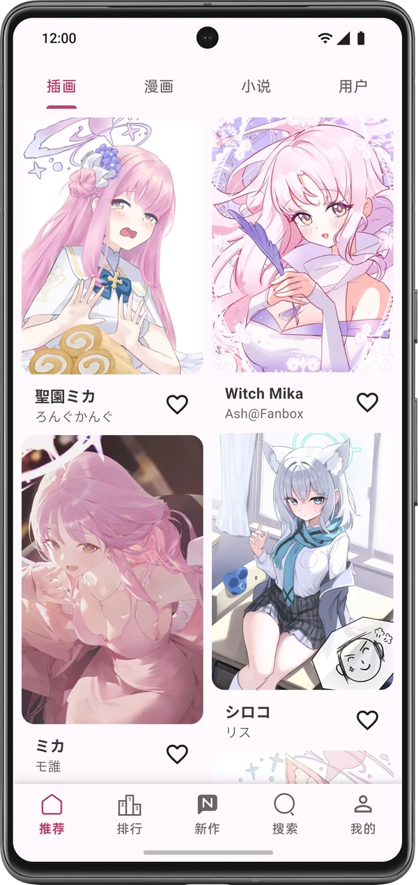
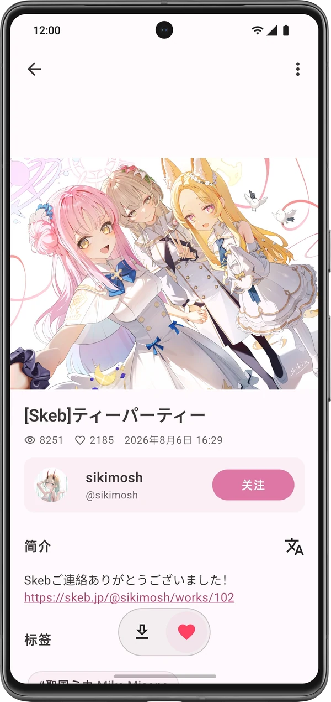
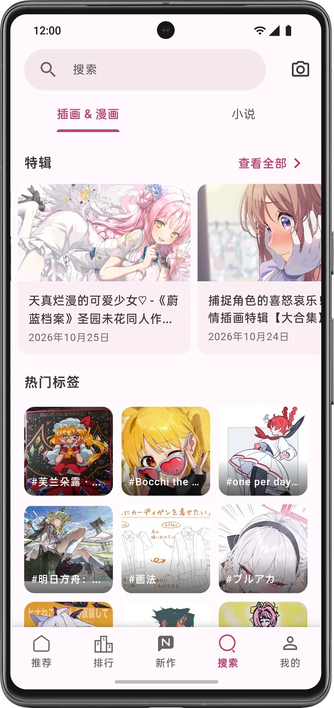
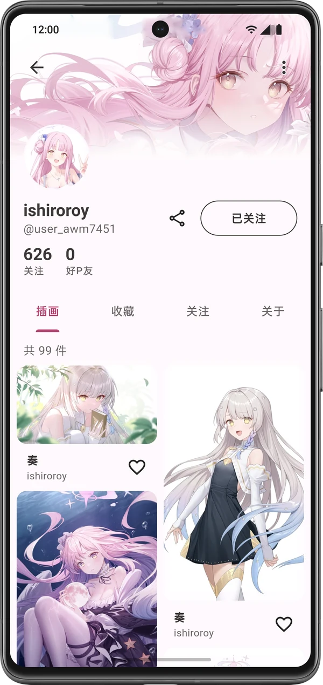
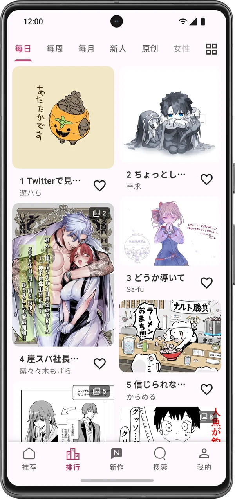
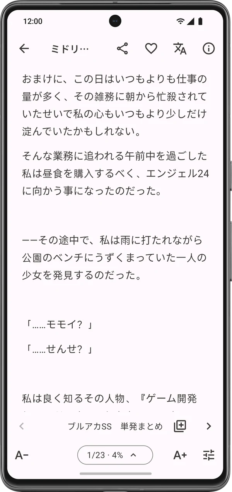
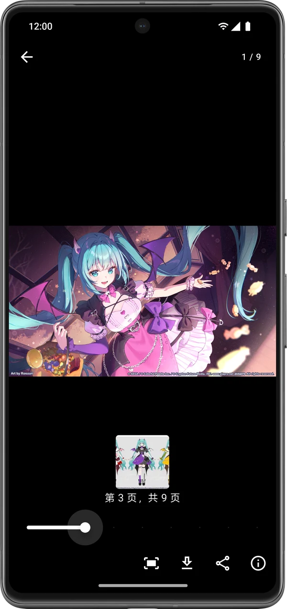
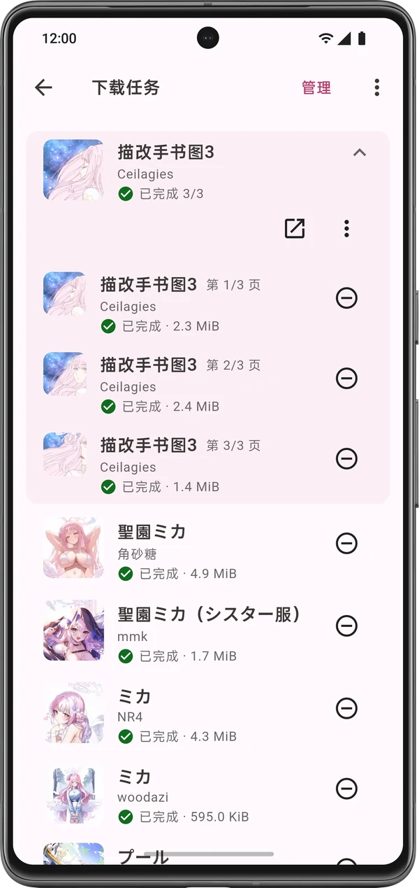

<div align="center">


[](https://github.com/Lopution/Parfait/releases/latest)
[](#download)
[](LICENSE)
[](https://github.com/Lopution/Parfait/actions/workflows/ci.yml)

**[⬇️ Download the latest release](https://github.com/Lopution/Parfait/releases/latest)** · **[FAQ](#faq)** · **[Contact](#contact)**

[简体中文](README.md) | English

</div>

> [!NOTE]
> Parfait is an unofficial client and is not affiliated with pixiv Inc. All works belong to their creators; downloads are for your personal collection, so please do not re-upload them or use them commercially.

Parfait is an unofficial pixiv client for Android, rewritten from the discontinued open-source Pixiv Func. It aims to make browsing, novel reading and bulk downloads work in mainland China without keeping a proxy on.

- **No proxy needed**: browsing and downloads need no proxy; only the first sign-in does (see [Signing in](#signing-in)). The image source defaults to **Auto**, which picks the fastest of pixiv's own servers and public mirrors on your current network, and when a connection fails, the built-in **Layered connectivity probe** shows where.
- **Viewing and reading**: illustrations, manga, ugoira (savable as GIF) and novels. The novel reader shows inline illustrations, jumps between chapters, keeps pixiv markers in sync with your account and opens local TXT files. Tablets, foldables and phones in landscape get two-pane layouts.
- **Bulk downloads**: download a selection or every work of an artist and name files with your own template; when you save to a folder, illustrations and manga can also get their captions in a TXT file alongside.
- **No ads or analytics**: no ads, analytics or telemetry, and only the permissions the features need (see [FAQ](#faq)).

## Screenshots

<!-- The no-break spaces under the last row keep every column as wide as a screenshot: on a phone the table scrolls sideways instead of shrinking them. -->
<table align="center">
<tr>
<td align="center" valign="top"><br><b>Recommended</b><br><sub>Illustrations, manga, novels and users</sub></td>
<td align="center" valign="top"><br><b>Artwork</b><br><sub>Details, comments and related works</sub></td>
<td align="center" valign="top"><br><b>Search</b><br><sub>Features, trending tags, reverse image search</sub></td>
<td align="center" valign="top"><br><b>Artist</b><br><sub>Works, bookmarks and follows</sub></td>
</tr>
<tr>
<td align="center" valign="top"><br><b>Rankings</b><br><sub>33 categories, any past date</sub><br>&nbsp;&nbsp;&nbsp;&nbsp;&nbsp;&nbsp;&nbsp;&nbsp;&nbsp;&nbsp;&nbsp;&nbsp;&nbsp;&nbsp;&nbsp;&nbsp;&nbsp;&nbsp;&nbsp;&nbsp;&nbsp;&nbsp;&nbsp;&nbsp;&nbsp;&nbsp;&nbsp;&nbsp;&nbsp;&nbsp;&nbsp;&nbsp;&nbsp;&nbsp;&nbsp;&nbsp;&nbsp;&nbsp;&nbsp;&nbsp;</td>
<td align="center" valign="top"><br><b>Novel reader</b><br><sub>Font, colours and one-tap translation</sub><br>&nbsp;&nbsp;&nbsp;&nbsp;&nbsp;&nbsp;&nbsp;&nbsp;&nbsp;&nbsp;&nbsp;&nbsp;&nbsp;&nbsp;&nbsp;&nbsp;&nbsp;&nbsp;&nbsp;&nbsp;&nbsp;&nbsp;&nbsp;&nbsp;&nbsp;&nbsp;&nbsp;&nbsp;&nbsp;&nbsp;&nbsp;&nbsp;&nbsp;&nbsp;&nbsp;&nbsp;&nbsp;&nbsp;&nbsp;&nbsp;</td>
<td align="center" valign="top"><br><b>Viewer</b><br><sub>Scrub through pages, save and share</sub><br>&nbsp;&nbsp;&nbsp;&nbsp;&nbsp;&nbsp;&nbsp;&nbsp;&nbsp;&nbsp;&nbsp;&nbsp;&nbsp;&nbsp;&nbsp;&nbsp;&nbsp;&nbsp;&nbsp;&nbsp;&nbsp;&nbsp;&nbsp;&nbsp;&nbsp;&nbsp;&nbsp;&nbsp;&nbsp;&nbsp;&nbsp;&nbsp;&nbsp;&nbsp;&nbsp;&nbsp;&nbsp;&nbsp;&nbsp;&nbsp;</td>
<td align="center" valign="top"><br><b>Downloads</b><br><sub>Grouped by work, pause and resume</sub><br>&nbsp;&nbsp;&nbsp;&nbsp;&nbsp;&nbsp;&nbsp;&nbsp;&nbsp;&nbsp;&nbsp;&nbsp;&nbsp;&nbsp;&nbsp;&nbsp;&nbsp;&nbsp;&nbsp;&nbsp;&nbsp;&nbsp;&nbsp;&nbsp;&nbsp;&nbsp;&nbsp;&nbsp;&nbsp;&nbsp;&nbsp;&nbsp;&nbsp;&nbsp;&nbsp;&nbsp;&nbsp;&nbsp;&nbsp;&nbsp;</td>
</tr>
</table>

## More features

- **Search**: completes each keyword separately and filters by bookmark count, date and AI-generated works; reverse image search with SauceNAO, IQDB, ascii2d and TinEye.
- **Bookmarks and series**: bookmarks with tags, watch later and history; follow manga and novel series and continue from the episode you reached. Bookmarks, follows and series subscriptions made offline are kept on the device and sent once you are back online.
- **Muting**: mute tags, users or single works, or hide R-18 and AI-generated works locally.
- **Comments and translation**: comment on the artwork page with emoji and stamps; translate comments and novels with Google, Baidu, Index Translate or any OpenAI-compatible endpoint.
- **Accounts and backup**: switch between several accounts; back up settings, mute lists and history, and import them on another device.
- **Customization**: choose the bottom bar pages, the start page and the grid density; take theme colors from your wallpaper; English, 简体中文, 日本語 and Русский.

## Download

Download an APK from [Releases](https://github.com/Lopution/Parfait/releases/latest) (**Android 10** or later):

| File | For |
|---|---|
| `parfait-v<version>-github-arm64-v8a.apk` | Almost every phone; pick this if unsure |
| `parfait-v<version>-github-armeabi-v7a.apk` | Older 32-bit devices |

Parfait is released on GitHub Releases only. Copies on cloud drives, in group chats or elsewhere are third-party reposts; the [FAQ](#faq) shows how to check the signature. Later updates are under **Me → About → Check for updates** in the app, or track this repository with [Obtainium](https://github.com/ImranR98/Obtainium).

A Windows build is in preparation and will ship as a preview.

## Signing in

pixiv only supports signing in on its official web page. The page, including its human verification, opens in a WebView that uses the system network rather than Parfait's direct connection, so **the first sign-in or registration needs a proxy set up in the system or another app**. After that, browsing and downloads need no proxy.

Already signed in on another device? There, open **Me → Accounts → Export account credential**, then choose **Log in with clipboard data** on the new device's sign-in page; no proxy is needed.

## FAQ

<details>
<summary>Pages or images load slowly or not at all?</summary>

1. Open **Me → Settings → Network**, run the **Layered connectivity probe** and switch the network mode as it suggests.
2. If pages open but images are slow, choose **Auto**, another mirror or a **Custom reverse proxy** under **Me → Settings → Network → Image source**.

</details>

<details>
<summary>Where are downloads saved?</summary>

By default, in the **Parfait** album of your gallery. Under **Me → Settings → Download settings → Save location** you can pick a custom album name or any folder through the system folder picker; file name templates are on the **Download settings** page.

</details>

<details>
<summary>How can I tell an APK is an official release?</summary>

Every APK is signed with the same certificate. On the phone you can check it with [AppVerifier](https://github.com/soupslurpr/AppVerifier); package name and SHA-256 fingerprint should be:

```text
io.github.lopution.parfait
D0:B4:1A:FC:87:B7:D2:07:51:1A:52:BD:8C:CC:A6:56:3C:67:3C:2D:F1:0A:67:71:D1:C3:38:4A:B6:5C:B1:12
```

On a computer, use `apksigner` from the Android SDK:

```bash
apksigner verify --print-certs parfait-v<version>-github-arm64-v8a.apk
# The output should contain:
# Signer #1 certificate SHA-256 digest: d0b41afc87b7d207511a52bd8ccca6563c673c2df10a6771d1c3384ab65cb112
```

When you update through **Check for updates**, the app verifies the signed version manifest and the new APK's hash and signing certificate before handing it to the system installer.

</details>

<details>
<summary>Which permissions does Parfait ask for, and where does data go?</summary>

Network, vibration (haptics) and installing apps (in-app updates only). From Android 17, Parfait also asks for **Nearby devices**, and only when an image source, DoH, translation endpoint or system proxy you set is on your local network.

Login credentials stay in the system's secure storage, and logs stay on the device. Text or images go to the service you chose only when you translate or search by image.

With the image source on **Auto** (the default), the app requests a test image from pixiv's own servers and from the public mirrors pixiv.re, pixiv.nl and pixiv.cat, then loads images through the fastest. All three mirrors receive the test request, and once a mirror is chosen, its operator can see your IP address and which images you load. To keep images off third-party mirrors, choose **Official** under **Me → Settings → Network → Image source**.

</details>

## Contact

- Bug reports and feature requests: [GitHub Issues](https://github.com/Lopution/Parfait/issues). Attaching the log from **Me → About → Export logs** helps; check it for anything you would rather keep private before uploading.
- Please report security issues privately as described in [SECURITY.md](SECURITY.md), not in a public issue.
- Email: [fuyian533@gmail.com](mailto:fuyian533@gmail.com)

## Contributing and acknowledgements

Issues and pull requests are welcome. See [CONTRIBUTING.md](CONTRIBUTING.md) for how to build and the project conventions.

<details>
<summary>How it works</summary>

The interface and app logic are written in Flutter (Riverpod + go_router). Requests to pixiv's API, images and downloads go through a Rust network layer adapted from [rhttp](https://codeberg.org/Tienisto/rhttp) (`reqwest` + `rustls` + `tokio`, bridged with `flutter_rust_bridge`): direct access needs control over the TLS handshake (ECH, leaving out SNI) and name resolution, which Dart's own `HttpClient` does not offer. This layer handles pixiv's domains only and never touches other apps' traffic.

- **Connection methods**: tries ECH (through Cloudflare), DoH then connect, and a handshake without SNI (image servers only) in turn, and remembers the one that works; with **Network mode** set to **Direct only**, it uses the system network alone. Whatever the method, `rustls` verifies the full certificate chain and the domain, and no route can turn that off.
- **Image routes**: for each network (a carrier or a Wi-Fi), the app records how fast and how smoothly each route loads images, uses the fastest, and tries another now and then while preloading. These records stay on the device.
- **Connectivity probe**: checks system DNS, DoH, TCP reachability and each method's TLS handshake in turn, finds the step that fails, and suggests settings.

</details>

- **Pixiv Func** by git-xiaocao. The original repository is no longer available; the source archive this project referred to is [svenfuss/pixiv_func_mobile](https://github.com/svenfuss/pixiv_func_mobile). See [NOTICE](NOTICE) for attribution and changes.
- **[PixEz](https://github.com/Notsfsssf/pixez-flutter)** and **[Pixiv-Shaft](https://github.com/CeuiLiSA/Pixiv-Shaft)**: references for design and implementation.
- **[rhttp](https://codeberg.org/Tienisto/rhttp)**: the Rust HTTP client behind the network layer.
- **[LinuxDo community](https://linux.do/)**: thanks for the support and testing feedback.

<a href="https://linux.do/" aria-label="LinuxDo community">
  
</a>

## License

[AGPL-3.0-only](LICENSE)
