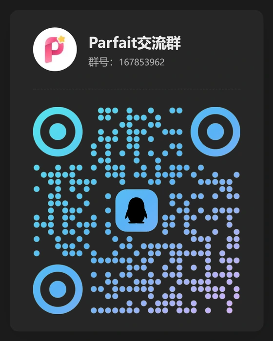

<div align="center">


[](https://github.com/Lopution/Parfait/releases/latest)
[](#下载与安装)
[](LICENSE)
[](https://github.com/Lopution/Parfait/actions/workflows/ci.yml)

**[⬇️ 下载最新版](https://github.com/Lopution/Parfait/releases/latest)** · **[常见问题](#常见问题)** · **[交流与反馈](#交流与反馈)**

简体中文 | [English](README.en.md)

</div>

> [!NOTE]
> 本项目是非官方的第三方客户端，与 pixiv Inc. 无关。作品版权归原作者所有，下载内容仅供个人收藏，请勿二次上传或商用。
>
> Parfait 目前处于公开测试阶段，欢迎通过 [Issues](https://github.com/Lopution/Parfait/issues) 反馈问题。

Parfait 是 Android 上的第三方 pixiv 客户端，源自开源项目 Pixiv Func。

由于原项目已停止维护，加上国内直连环境经常变化，本项目基于 Flutter 与 Rust 对客户端进行了重写：界面采用 Material Design 3，底层网络栈用 Rust 重新实现，重点解决日常直连、看图加载与批量下载的痛点：

- **开箱直连**：浏览与下载无需长开代理（仅首次登录除外，见[登录](#登录)）。连不上时，可以用内置的「分层连通性探测」排查是 DNS 污染还是 SNI 阻断。直连只作用于 pixiv 的域名，不接管其他应用的流量。
- **看图与阅读**：支持插画、漫画、动图（可导出 GIF）与小说阅读；支持漫画和小说系列追更、多源以图搜图、评论区一键翻译，并针对平板、折叠屏和横屏做了双栏适配。
- **好用的批量下载**：支持多选批量下载或一键下载画师全部作品；多页作品自动归组，支持断点续传、自定义命名模板及导出同名 TXT 作品简介。
- **克制、无打扰**：没有任何广告、统计或遥测。权限只有网络、振动（触感反馈）和安装应用（仅用于应用内更新）；Android 17 起，只有当你设置的图片源、DoH、翻译接口或系统代理位于局域网时，才会额外申请「附近设备」权限。账号凭据保存在系统安全存储中，日志只保存在本机。

## 截图

<!-- The no-break spaces under the last row keep every column as wide as a screenshot: on a phone the table scrolls sideways instead of shrinking them. -->
<table align="center">
<tr>
<td align="center" valign="top"><br><b>推荐</b><br><sub>插画、漫画、<br>小说与用户推荐</sub></td>
<td align="center" valign="top"><br><b>作品详情</b><br><sub>浏览作品信息、<br>评论与相关推荐</sub></td>
<td align="center" valign="top"><br><b>搜索</b><br><sub>特辑、热门标签，<br>拍照反向搜图</sub></td>
<td align="center" valign="top"><br><b>画师主页</b><br><sub>作品、收藏与关注列表</sub></td>
</tr>
<tr>
<td align="center" valign="top"><br><b>排行</b><br><sub>33 个细分分类，<br>支持按日期回看</sub><br>&nbsp;&nbsp;&nbsp;&nbsp;&nbsp;&nbsp;&nbsp;&nbsp;&nbsp;&nbsp;&nbsp;&nbsp;&nbsp;&nbsp;&nbsp;&nbsp;&nbsp;&nbsp;&nbsp;&nbsp;&nbsp;&nbsp;&nbsp;&nbsp;&nbsp;&nbsp;&nbsp;&nbsp;&nbsp;&nbsp;&nbsp;&nbsp;&nbsp;&nbsp;&nbsp;&nbsp;&nbsp;&nbsp;&nbsp;&nbsp;</td>
<td align="center" valign="top"><br><b>小说阅读</b><br><sub>字号与配色可调，<br>支持一键翻译</sub><br>&nbsp;&nbsp;&nbsp;&nbsp;&nbsp;&nbsp;&nbsp;&nbsp;&nbsp;&nbsp;&nbsp;&nbsp;&nbsp;&nbsp;&nbsp;&nbsp;&nbsp;&nbsp;&nbsp;&nbsp;&nbsp;&nbsp;&nbsp;&nbsp;&nbsp;&nbsp;&nbsp;&nbsp;&nbsp;&nbsp;&nbsp;&nbsp;&nbsp;&nbsp;&nbsp;&nbsp;&nbsp;&nbsp;&nbsp;&nbsp;</td>
<td align="center" valign="top"><br><b>看图</b><br><sub>多页作品拖动跳页，<br>保存与分享</sub><br>&nbsp;&nbsp;&nbsp;&nbsp;&nbsp;&nbsp;&nbsp;&nbsp;&nbsp;&nbsp;&nbsp;&nbsp;&nbsp;&nbsp;&nbsp;&nbsp;&nbsp;&nbsp;&nbsp;&nbsp;&nbsp;&nbsp;&nbsp;&nbsp;&nbsp;&nbsp;&nbsp;&nbsp;&nbsp;&nbsp;&nbsp;&nbsp;&nbsp;&nbsp;&nbsp;&nbsp;&nbsp;&nbsp;&nbsp;&nbsp;</td>
<td align="center" valign="top"><br><b>下载任务</b><br><sub>多页作品自动分组，<br>支持暂停与续传</sub><br>&nbsp;&nbsp;&nbsp;&nbsp;&nbsp;&nbsp;&nbsp;&nbsp;&nbsp;&nbsp;&nbsp;&nbsp;&nbsp;&nbsp;&nbsp;&nbsp;&nbsp;&nbsp;&nbsp;&nbsp;&nbsp;&nbsp;&nbsp;&nbsp;&nbsp;&nbsp;&nbsp;&nbsp;&nbsp;&nbsp;&nbsp;&nbsp;&nbsp;&nbsp;&nbsp;&nbsp;&nbsp;&nbsp;&nbsp;&nbsp;</td>
</tr>
</table>

## 功能一览

- **浏览与检索**：推荐流与 pixivision 特辑；插画（21 类）与小说（12 类）排行，支持按日期回看及自定义排序和隐藏；搜索支持按收藏数、发布时间、AI 作品筛选；内置 SauceNAO、IQDB、ascii2d、TinEye 反向搜图。
- **网络与图源**：网络模式可选自动、仅直连、兼容优先；图片源支持按当前网络自动测速选源、pixiv.re 等公共镜像及自定义反代。
- **小说与追更**：阅读器支持调节字号、行距及纸张、护眼、夜间配色；支持漫画与小说系列追更；支持导入本地 TXT 小说（自动识别编码）。
- **收藏与屏蔽**：支持带标签收藏、关注、稍后再看、浏览历史；支持按标签、用户、单篇作品屏蔽，或在本地隐藏 R-18、AI 生成作品。
- **评论与翻译**：支持发送 Emoji 与贴图；评论和小说可用 Google 翻译、百度翻译、豆包（登录自己的账号）或自定义 OpenAI 兼容接口翻译。只有在你主动翻译或搜图时，相应的文字或图片才会发给所选服务。
- **个性化与跨设备**：多账号切换与跨设备迁移登录；设置、屏蔽列表与浏览历史可备份和导入；底栏页面和启动页可自定义；界面支持简体中文、English、日本語、Русский，主题可跟随系统壁纸取色。

## 下载与安装

请前往 [Releases](https://github.com/Lopution/Parfait/releases/latest) 页面下载 APK（要求 **Android 10** 及以上版本）：

| 文件 | 适用设备 |
|---|---|
| `parfait-v版本号-github-arm64-v8a.apk` | 绝大多数手机，不确定选它即可 |
| `parfait-v版本号-github-armeabi-v7a.apk` | 较旧的 32 位设备 |

> Windows 版本正在适配中，后续将以预览版形式发布。

本项目**仅在 GitHub Releases 发布**。网盘、群文件等其他渠道均为第三方转载，请以 Releases 为准或核对下方签名指纹。后续更新可直接在应用内「我的 → 关于 → 检查更新」完成，也可使用 [Obtainium](https://github.com/ImranR98/Obtainium) 订阅本仓库。

<details>
<summary>核对 APK 签名证书指纹</summary>

Releases 中的所有 APK 均使用同一证书签名。手机端可使用 [AppVerifier](https://github.com/soupslurpr/AppVerifier) 验证，包名与 SHA-256 指纹如下：

```text
io.github.lopution.parfait
D0:B4:1A:FC:87:B7:D2:07:51:1A:52:BD:8C:CC:A6:56:3C:67:3C:2D:F1:0A:67:71:D1:C3:38:4A:B6:5C:B1:12
```

电脑端可使用 Android SDK 的 `apksigner` 验证：

```bash
apksigner verify --print-certs parfait-v版本号-github-arm64-v8a.apk
# 输出应包含：
# Signer #1 certificate SHA-256 digest: d0b41afc87b7d207511a52bd8ccca6563c673c2df10a6771d1c3384ab65cb112
```

</details>

## 登录

Parfait 通过 pixiv 官方网页完成 OAuth 登录。登录页（包括其中的人机验证）在应用内的 WebView 里打开，走的是系统网络，不经过 Parfait 的直连网络层，因此**首次登录或注册时仍需在系统或其他应用中开启代理**；登录拿到凭据后，日常浏览和下载即可全程直连。

如果另一台设备上已经登录过 Parfait，可以在旧设备的「我的 → 账号管理」中点击「导出账号凭据」，随后在新设备登录页选择「使用剪贴板数据登录」，即可免代理直接迁移登录状态。

## 技术与网络实现

Parfait 的界面与业务逻辑使用 Flutter 编写（Riverpod 状态管理 + go_router 路由）。访问 pixiv 的接口、图片和下载请求没有使用 Dart 自带的 `HttpClient`，而是走基于 [rhttp](https://codeberg.org/Tienisto/rhttp) 改造的 Rust 网络层（`reqwest` + `rustls` + `tokio`，通过 `flutter_rust_bridge` 接入）。

之所以引入 Rust 网络栈，是因为 Dart 标准库无法控制 TLS 握手细节（ECH、不发送 SNI）和域名解析方式，而直连恰恰需要这些：

1. **多种连接方式与完整证书校验**
   针对 pixiv 的域名，Rust 层会依次尝试以下几种方式，并记住能用的那一种：
   - **ECH（Encrypted Client Hello）**：经 Cloudflare 完成加密握手，真实域名藏在加密的 ClientHello 里；
   - **DoH 解析后连接**：通过加密 DNS 拿到未被污染的地址再连接；
   - **免 SNI 握手**：只用于 pixiv 的图片服务器（如 `i.pximg.net`），握手时不发送明文 SNI；
   - **系统直连**：在「我的 → 网络 → 网络模式」中选择「仅直连」时只走这一种（在中国大陆网络下通常需要自备代理）。

   **安全性说明**：无论走哪种方式，都由 `rustls` 完整校验证书链和域名，没有任何一条线路可以关掉校验；如果连上的不是 pixiv 的服务器，握手会直接失败。

2. **分层连通性探测**
   网络异常时不必盲目试错：内置探测器会依次检查系统 DNS 与 DoH 的解析结果、目标地址的 TCP 连通性，以及上述各种方式的 TLS 握手是否成功，直接判断当前网络是 DNS 污染还是 SNI 阻断，并给出对应的设置建议。

3. **本地存储与可靠性**
   - **离线操作队列**：断网或弱网时的收藏、关注、追更等操作会先写入本地 SQLite 队列，启动时和网络恢复后自动补发，不会丢失。
   - **应用内更新校验**：版本清单带有签名；下载新版 APK 后，会先校验文件哈希和 APK 签名证书，再交给系统安装器，防止下载链路被劫持替换。

## 常见问题

<details>
<summary>打不开页面或图片加载很慢？</summary>

1. 打开「我的 → 网络」，运行「分层连通性探测」，根据探测结论切换网络模式。
2. 若页面能打开但图片加载慢，可在「我的 → 网络 → 图片源」中选择「自动」或其他镜像。

</details>

<details>
<summary>下载的文件保存在哪里？</summary>

默认保存在系统相册的「Parfait」相册中。可在「我的 → 下载设置 → 保存位置」中改成自定义相册，或通过系统目录选择器指定任意文件夹；文件命名模板同样在该页面配置。

</details>

<details>
<summary>遇到问题如何反馈？</summary>

请在 [Issues](https://github.com/Lopution/Parfait/issues) 中提交问题说明与复现步骤。建议在「我的 → 关于 → 导出日志」中导出本地日志一并附上（上传前请留意日志中是否有你不希望公开的信息）。

若发现安全漏洞，请勿提交公开 Issue，请按 [SECURITY.md](SECURITY.md) 中的说明私下联系。

</details>

## 交流与反馈

- 问题反馈与功能建议：[GitHub Issues](https://github.com/Lopution/Parfait/issues)
- QQ 交流群：**167853962**
- 邮箱：[fuyian533@gmail.com](mailto:fuyian533@gmail.com)



## 参与开发与致谢

欢迎提交 Issue 和 Pull Request，构建流程与代码规范请参考 [CONTRIBUTING.md](CONTRIBUTING.md)。

- **Pixiv Func**：原作者 git-xiaocao（小草）。原仓库已无法访问，本项目参考的源码存档见 [svenfuss/pixiv_func_mobile](https://github.com/svenfuss/pixiv_func_mobile)，版权归属与修改说明见 [NOTICE](NOTICE)。
- **[PixEz](https://github.com/Notsfsssf/pixez-flutter)** 与 **[Pixiv-Shaft](https://github.com/CeuiLiSA/Pixiv-Shaft)**：设计与实现上的参考。
- **[rhttp](https://codeberg.org/Tienisto/rhttp)**：网络层所用的 Rust HTTP 客户端。
- **[LinuxDo 社区](https://linux.do/)**：感谢社区朋友们的支持与测试反馈。

<a href="https://linux.do/" aria-label="LinuxDo 社区">
  
</a>

## 许可证

[AGPL-3.0-only](LICENSE)
