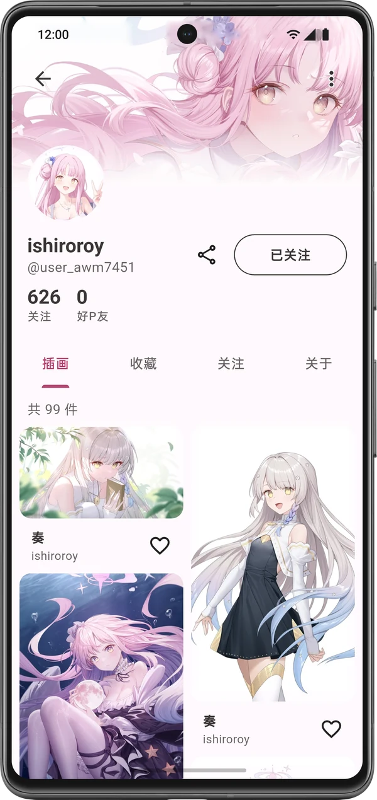
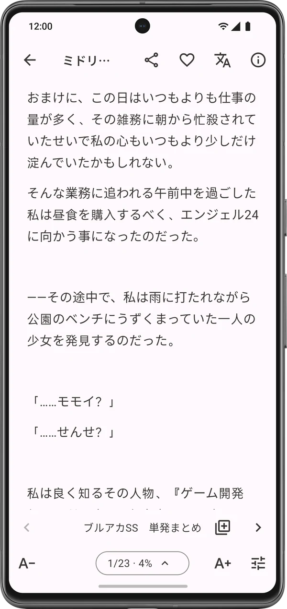
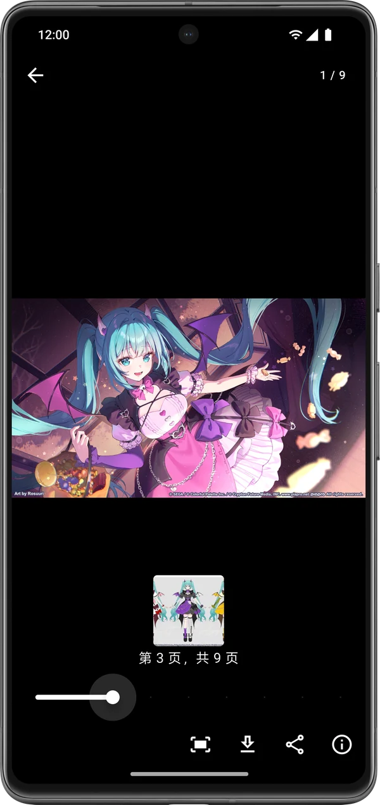
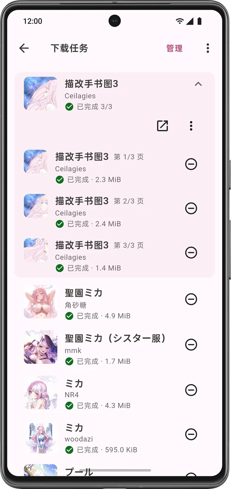
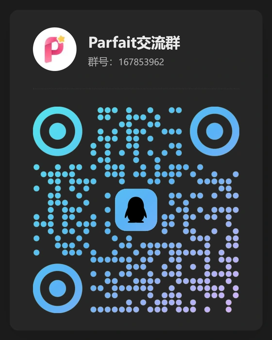

<div align="center">


[](https://github.com/Lopution/Parfait/releases/latest)
[](#下载与安装)
[](LICENSE)
[](https://github.com/Lopution/Parfait/actions/workflows/ci.yml)

**[⬇️ 下载最新版](https://github.com/Lopution/Parfait/releases/latest)** · **[常见问题](#常见问题)** · **[交流与反馈](#交流与反馈)**

简体中文 | [English](README.en.md)

</div>

> [!NOTE]
> 本项目是非官方的第三方客户端，与 pixiv Inc. 无关。作品版权归原作者所有，下载内容仅供个人收藏，请勿二次上传或商用。

Parfait 是 Android 上的第三方 pixiv 客户端，基于已停止维护的开源项目 Pixiv Func 重写，目标是在不长开代理的情况下，也能正常浏览作品、阅读小说和批量下载。

- **免代理直连**：日常浏览与下载均可直连 pixiv，仅首次登录需要代理（见[登录](#登录)）。应用会按当前网络自动选择最快的图片线路；遇到连接问题时，可用内置的「分层连通性探测」排查原因。
- **看图与阅读**：支持插画、漫画、动图（可导出 GIF）与小说阅读。小说支持正文插图、章节跳转与 pixiv 书签同步，也可导入本地 TXT；针对平板、折叠屏和横屏做了双栏适配。
- **批量下载**：支持多选下载或一键下载画师全部作品，可按模板自定义文件名，并顺带导出同名的 TXT 作品简介。
- **无广告与统计**：不包含任何广告、统计或遥测，仅申请必要的系统权限（见[常见问题](#常见问题)）。

## 截图

<!-- The no-break spaces under the last row keep every column as wide as a screenshot: on a phone the table scrolls sideways instead of shrinking them. -->
<table align="center">
<tr>
<td align="center" valign="top"><br><b>推荐</b><br><sub>插画、漫画、<br>小说与用户推荐</sub></td>
<td align="center" valign="top"><br><b>作品详情</b><br><sub>浏览作品信息、<br>评论与相关推荐</sub></td>
<td align="center" valign="top"><br><b>搜索</b><br><sub>特辑、热门标签，<br>拍照反向搜图</sub></td>
<td align="center" valign="top"><br><b>画师主页</b><br><sub>作品、收藏与关注列表</sub></td>
</tr>
<tr>
<td align="center" valign="top"><br><b>排行</b><br><sub>33 个细分分类，<br>支持按日期回看</sub><br>&nbsp;&nbsp;&nbsp;&nbsp;&nbsp;&nbsp;&nbsp;&nbsp;&nbsp;&nbsp;&nbsp;&nbsp;&nbsp;&nbsp;&nbsp;&nbsp;&nbsp;&nbsp;&nbsp;&nbsp;&nbsp;&nbsp;&nbsp;&nbsp;&nbsp;&nbsp;&nbsp;&nbsp;&nbsp;&nbsp;&nbsp;&nbsp;&nbsp;&nbsp;&nbsp;&nbsp;&nbsp;&nbsp;&nbsp;&nbsp;</td>
<td align="center" valign="top"><br><b>小说阅读</b><br><sub>字号与配色可调，<br>支持一键翻译</sub><br>&nbsp;&nbsp;&nbsp;&nbsp;&nbsp;&nbsp;&nbsp;&nbsp;&nbsp;&nbsp;&nbsp;&nbsp;&nbsp;&nbsp;&nbsp;&nbsp;&nbsp;&nbsp;&nbsp;&nbsp;&nbsp;&nbsp;&nbsp;&nbsp;&nbsp;&nbsp;&nbsp;&nbsp;&nbsp;&nbsp;&nbsp;&nbsp;&nbsp;&nbsp;&nbsp;&nbsp;&nbsp;&nbsp;&nbsp;&nbsp;</td>
<td align="center" valign="top"><br><b>看图</b><br><sub>多页作品拖动跳页，<br>保存与分享</sub><br>&nbsp;&nbsp;&nbsp;&nbsp;&nbsp;&nbsp;&nbsp;&nbsp;&nbsp;&nbsp;&nbsp;&nbsp;&nbsp;&nbsp;&nbsp;&nbsp;&nbsp;&nbsp;&nbsp;&nbsp;&nbsp;&nbsp;&nbsp;&nbsp;&nbsp;&nbsp;&nbsp;&nbsp;&nbsp;&nbsp;&nbsp;&nbsp;&nbsp;&nbsp;&nbsp;&nbsp;&nbsp;&nbsp;&nbsp;&nbsp;</td>
<td align="center" valign="top"><br><b>下载任务</b><br><sub>多页作品自动分组，<br>支持暂停与续传</sub><br>&nbsp;&nbsp;&nbsp;&nbsp;&nbsp;&nbsp;&nbsp;&nbsp;&nbsp;&nbsp;&nbsp;&nbsp;&nbsp;&nbsp;&nbsp;&nbsp;&nbsp;&nbsp;&nbsp;&nbsp;&nbsp;&nbsp;&nbsp;&nbsp;&nbsp;&nbsp;&nbsp;&nbsp;&nbsp;&nbsp;&nbsp;&nbsp;&nbsp;&nbsp;&nbsp;&nbsp;&nbsp;&nbsp;&nbsp;&nbsp;</td>
</tr>
</table>

## 更多功能

- **搜索**：支持多个关键词分别补全，可按收藏数、发布时间和是否 AI 作品筛选；以图搜图支持 SauceNAO、IQDB、ascii2d 和 TinEye。
- **收藏与追更**：支持带标签收藏、稍后再看与浏览历史；支持漫画和小说系列追更，并记住读到第几话。断网时的收藏、关注和追更会先暂存在本地，联网后自动补发。
- **内容屏蔽**：支持按标签、用户或单篇作品屏蔽，也可在本地隐藏 R-18 和 AI 生成作品。
- **评论与翻译**：支持在作品页发表带 Emoji 和贴图的评论；评论和小说可使用 Google、百度、Index Translate 或自定义 OpenAI 兼容接口翻译。
- **多账号与备份**：支持多账号切换；设置、屏蔽列表和浏览历史可导出备份，并在其他设备上导入。
- **个性化**：底栏页面、启动页和网格密度均可自定义；主题支持跟随系统壁纸取色；界面支持简体中文、English、日本語和 Русский。

## 下载与安装

请前往 [Releases](https://github.com/Lopution/Parfait/releases/latest) 下载 APK（要求 **Android 10** 及以上）：

| 文件 | 适用设备 |
|---|---|
| `parfait-v版本号-github-arm64-v8a.apk` | 绝大多数手机，不确定选它即可 |
| `parfait-v版本号-github-armeabi-v7a.apk` | 较旧的 32 位设备 |

本项目仅在 GitHub Releases 发布，网盘、群文件等渠道均为第三方转载，可按[常见问题](#常见问题)中的方法核对签名。后续更新可在应用内「我的 → 关于 → 检查更新」完成，也可使用 [Obtainium](https://github.com/ImranR98/Obtainium) 订阅本仓库。

Windows 版本正在适配中，后续将以预览版形式发布。

## 登录

pixiv 仅支持通过官方网页登录。登录页（包括其中的人机验证）在应用内的 WebView 中打开，使用系统网络，不经过 Parfait 的直连层，因此**首次登录或注册时仍需在系统或其他应用中开启代理**；登录成功后，日常浏览和下载即无需代理。

如果其他设备上已经登录过 Parfait，可在旧设备的「我的 → 账号管理」中点击「导出账号凭据」，再在新设备的登录页选择「使用剪贴板数据登录」，即可免代理迁移登录状态。

## 常见问题

<details>
<summary>打不开页面，或者图片加载很慢？</summary>

1. 在「我的 → 设置 → 网络」中运行「分层连通性探测」，根据探测结论切换网络模式。
2. 若页面能打开但图片加载慢，可在「我的 → 设置 → 网络 → 图片源」中选择「自动」、切换其他镜像，或填写自定义反代。

</details>

<details>
<summary>下载的文件保存在哪里？</summary>

默认保存在系统相册的「Parfait」相册中。可在「我的 → 设置 → 下载设置 → 保存位置」中改为其他相册，或通过系统目录选择器指定任意文件夹；文件命名模板也在「下载设置」中修改。

</details>

<details>
<summary>如何确认安装包是官方发布的？</summary>

所有 APK 均使用同一张证书签名。手机端可使用 [AppVerifier](https://github.com/soupslurpr/AppVerifier) 核对包名与 SHA-256 指纹：

```text
io.github.lopution.parfait
D0:B4:1A:FC:87:B7:D2:07:51:1A:52:BD:8C:CC:A6:56:3C:67:3C:2D:F1:0A:67:71:D1:C3:38:4A:B6:5C:B1:12
```

电脑端可使用 Android SDK 的 `apksigner` 验证：

```bash
apksigner verify --print-certs parfait-v版本号-github-arm64-v8a.apk
# 输出应包含：
# Signer #1 certificate SHA-256 digest: d0b41afc87b7d207511a52bd8ccca6563c673c2df10a6771d1c3384ab65cb112
```

通过「检查更新」安装新版本时，应用会先校验版本清单的签名，以及新 APK 的文件哈希和签名证书，再交由系统安装。

</details>

<details>
<summary>应用申请哪些权限，数据会发送到哪里？</summary>

权限仅包括网络、振动（触感反馈）和安装应用（仅用于应用内更新）。自 Android 17 起，仅当图片源、DoH、翻译接口或系统代理设为局域网地址时，才会额外申请「附近设备」权限。

账号凭据保存在系统安全存储中，日志仅保存在本机。只有在你主动翻译或搜图时，相应的文字或图片才会发送给所选服务。

</details>

## 交流与反馈

- 问题反馈与功能建议：[GitHub Issues](https://github.com/Lopution/Parfait/issues)。建议附上「我的 → 关于 → 导出日志」导出的日志，上传前请检查其中是否有不希望公开的信息。
- 安全漏洞请勿提交公开 Issue，请按 [SECURITY.md](SECURITY.md) 中的说明私下联系。
- QQ 交流群：**167853962**
- 邮箱：[fuyian533@gmail.com](mailto:fuyian533@gmail.com)



## 参与开发与致谢

欢迎提交 Issue 和 Pull Request，构建流程与代码规范请参考 [CONTRIBUTING.md](CONTRIBUTING.md)。

<details>
<summary>技术实现</summary>

界面与业务逻辑使用 Flutter 编写（Riverpod + go_router）。访问 pixiv 的接口、图片和下载请求经由基于 [rhttp](https://codeberg.org/Tienisto/rhttp) 改造的 Rust 网络层（`reqwest` + `rustls` + `tokio`，通过 `flutter_rust_bridge` 接入）：直连需要控制 TLS 握手（ECH、不发送 SNI）和域名解析，Dart 自带的 `HttpClient` 无法做到。该网络层只处理 pixiv 的域名，不接管其他应用的流量。

- **连接方式**：依次尝试 ECH（经 Cloudflare）、DoH 解析后连接和免 SNI 握手（仅用于图片服务器），并记住可用的方式；「网络模式」设为「仅直连」时只使用系统网络。无论采用哪种方式，证书链和域名均由 `rustls` 完整校验，任何线路都无法关闭校验。
- **图片线路**：按运营商或 Wi-Fi 分别记录各线路的速度与卡顿，使用最快的一条，并在预加载时少量试用其他线路。记录仅保存在本机。
- **连通性探测**：依次检查系统 DNS、DoH、TCP 连通性及各方式的 TLS 握手，定位故障环节并给出设置建议。

</details>

- **Pixiv Func**：原作者 git-xiaocao（小草）。原仓库已无法访问，本项目参考的源码存档见 [svenfuss/pixiv_func_mobile](https://github.com/svenfuss/pixiv_func_mobile)，版权归属与修改说明见 [NOTICE](NOTICE)。
- **[PixEz](https://github.com/Notsfsssf/pixez-flutter)** 与 **[Pixiv-Shaft](https://github.com/CeuiLiSA/Pixiv-Shaft)**：设计与实现上的参考。
- **[rhttp](https://codeberg.org/Tienisto/rhttp)**：网络层所用的 Rust HTTP 客户端。
- **[LinuxDo 社区](https://linux.do/)**：感谢社区朋友们的支持与测试反馈。

<a href="https://linux.do/" aria-label="LinuxDo 社区">
  
</a>

## 许可证

[AGPL-3.0-only](LICENSE)
